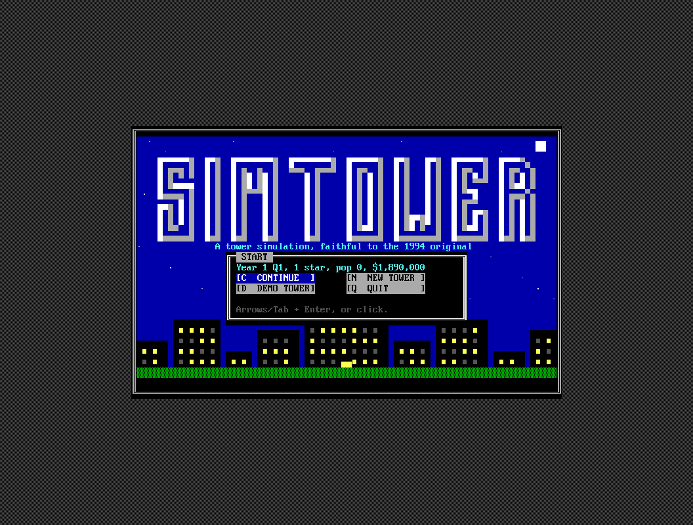
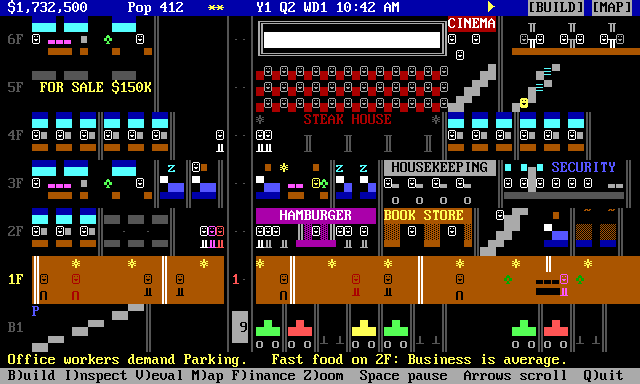
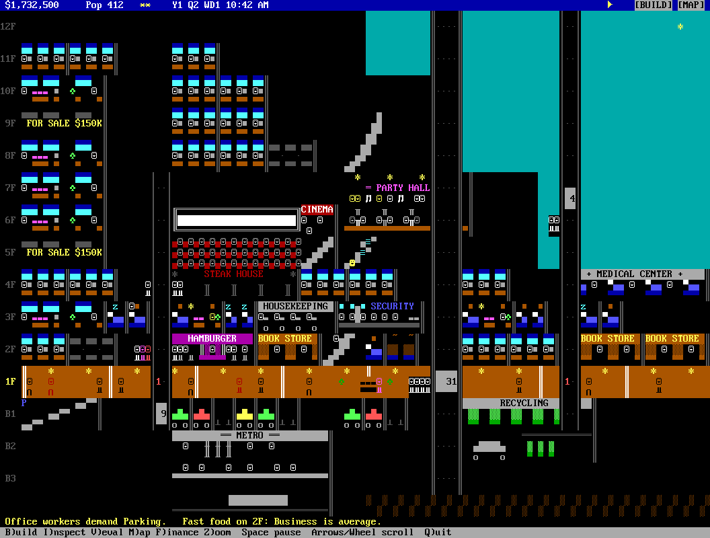
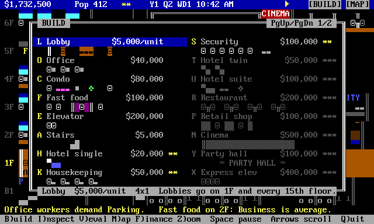
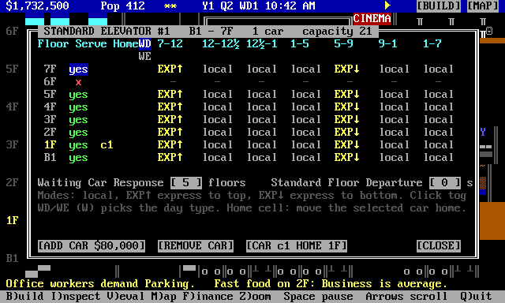

# Sim Tower (terminal version)

A faithful SimTower for the terminal: build a 100-story tower out of offices,
condos, hotels, shops and restaurants, keep the elevators moving and the
tenants happy, and climb from one star to the TOWER rating. It runs as a BBS
door (Synchronet, Mystic, any DOOR32 board) and just as well from a shell on
your own machine.



The simulation is a Go port of [tower-together](https://github.com/phulin/tower-together),
Patrick Hulin's reverse-engineering of the original 1994 SIMTOWER.EXE whose
state machine, elevator dispatch and economy were validated tick for tick
against the real binary running under emulation. The 16 per-tick reference
traces captured from the original replay identically in this port's test
suite, so the rent, the stress, the elevator behaviour and the star gates
are the original's, not approximations.

The presentation is CP437 text at one column per unit and three rows per
floor, in 16 colors, with drawn rooms and animation: workers at their desks,
guests asleep under rising z's, elevator cars with doors that open, people
walking the lobby and queueing at the shafts (up on the left, down on the
right, like the original).





This is an unofficial, clean-room reimplementation. SimTower is a trademark
of its owners; no original assets or code are included.

## Getting it

Download a release for your platform from the Releases page, or build from
source (Go 1.25 or newer):

```
git clone https://github.com/hmderdoc/sim-tower-terminal.git && cd sim-tower-terminal
make build          # -> ./simtower
```

Release binaries are built for Linux (amd64, arm64), Windows (amd64), macOS
(Intel, Apple Silicon) and FreeBSD. The simulation uses 64-bit integers, so
32-bit targets are not built.

## Playing from the command line (no BBS needed)

```
./simtower
```

It uses your terminal's size (80x24 minimum; bigger shows more floors and
units) and follows window resizes. The start menu offers Continue, New
tower, Demo tower and Quit. Your tower is saved to `data/<user>.json` next
to the binary on quit and at every in-game quarter.

Flags:

| Flag | Meaning |
|---|---|
| `-demo` | the scripted demo tower (the graphics showcase, no simulation) |
| `-size 132x50` | force a terminal size instead of probing |
| `-user NAME` | player name (save file name); default is the DOOR32 alias, else `$USER` |
| `-data DIR` | save directory (default `<binary dir>/data`) |
| `-log FILE` | debug log (default `<binary dir>/simtower.log`) |
| `-dropfile PATH` | DOOR32.SYS path for door mode (see below) |
| `-version` | print the version |
| `-trace` | log every input event to the log file (also a file named `trace` in the data dir) |

Terminal requirements: ANSI with CP437 glyphs and 16 colors. SyncTERM,
NetRunner, fTelnet, Qodem, and most xterm-style terminals with a CP437 font
or UTF-8 translation on the BBS side work. The mouse needs SGR mouse
reporting (SyncTERM has it; most modern terminals do). Without a mouse the
whole game is playable from the keyboard.

## Controls

Everything on screen is clickable: rooms and shafts (inspect), the status
row (funds opens Finance, speed cycles pause / normal / fast), the
`[BUILD]` and `[MAP]` buttons, every entry on the hotkey bar, and every
button in a window. The keyboard path is complete too.

| Key | Action |
|---|---|
| `B` | build palette (each item has its own letter; the tool stays armed after placing) |
| `I` / click | inspect a room, shaft or person (a left press that moves pans instead) |
| `V` | evaluation overlay: eval, pricing, hotel, off |
| `M` | overview map (click to jump) |
| `F` | finance report |
| `Z` | zoom out to one row per floor |
| `L` | message log |
| `Space` | pause / resume |
| `1` `2` | normal / fast |
| Arrows, PgUp/PgDn, Home | scroll (Home returns to the lobby) |
| Wheel / Shift+wheel / drag | scroll floors / scroll units / pan (left-drag with no tool armed, or right-drag any time) |
| `Enter` | left click at the keyboard cursor; `Shift`+arrows drag |
| `Esc` / right click | drop the tool or close the window |
| `Q` | save and quit |

Building: with a tool armed, the item's outline follows the mouse (white
where it can go, red with the reason on the message line where it can't).
Elevator shafts drag vertically; the elevator tool on an existing shaft adds
a car at that floor. Lobbies and floors drag horizontally. The bulldozer
drags across a run.





## Setting it up on a BBS

The door gets its connection one of two ways, decided automatically:

1. **DOOR32.SYS socket mode.** If a `DOOR32.SYS` dropfile says the caller is
   on a socket (comm type 2), the door takes over that socket handle directly:
   a file descriptor on Linux/Unix, a Winsock handle on Windows. This is the
   standard path on Synchronet, Mystic, ENiGMA, Talisman, WWIV and similar.
2. **Standard I/O mode.** With no socket dropfile it talks over
   stdin/stdout, for redirector front-ends and local play.

Saves are per caller, named after the DOOR32 alias.

### Synchronet

Copy or clone this directory to `xtrn/sim_tower`, build or drop in a binary
named `simtower` there, then either run the installer:

```
jsexec install-xtrn ../xtrn/sim_tower
```

or add the program by hand in SCFG (External Programs) with:

```
Command line:     simtower -dropfile %f
Native executable: Yes
Multiple users:    Yes
Drop file type:    DOOR32.SYS
Startup directory: ../xtrn/sim_tower
Required ARS:      ANSI AND COLS 80 AND ROWS 24
```

A 12x6 menu icon for the futureland shell is in `docs/icon.ans`
(install as `text/icons/simtower.bin` using the spec in `docs/icon_spec.txt`).

### Mystic

```
Command Line : /mystic/doors/simtower/simtower -dropfile DOOR32.SYS
Dropfile     : DOOR32.SYS
```

### Generic DOOR32 BBS

Have the BBS write a `DOOR32.SYS` into the node's work directory and launch
`simtower` from there (or pass `-dropfile <path>`).

### Terminal size

The door probes the caller's terminal with a cursor-position report (works
over telnet with SyncTERM, NetRunner, fTelnet, ...) and re-probes every few
seconds so a resized window is followed. Callers below 80x24 see a "too
small" screen until they enlarge the window. Force a size with `-size`.

## What is and isn't in

Simulated by the original's rules: offices, condos (sold once, refunded on
move-out), hotel singles/twins/suites with housekeeping, cockroaches,
fast food, restaurants, retail, cinemas with two showings and movie
changes, party halls, parking, recycling adequacy, security, medical,
metro, the cathedral and its 40-guest award path, standard / service /
express elevators with per-floor stops, home floors, waiting-car response
and departure delay, stairs and escalators with the original's transfer
limits, tenant stress and the three-tier evaluation, rent and price tiers,
quarterly rent, maintenance and the finance report, star progression gates,
terrorist bomb and fire events.

Not surfaced yet (the upstream sim has no state for them): VIP visits,
hidden treasure, Santa, the wedding ceremony animation, rain. Elevator
express-up / express-down period modes are written straight into the shaft
record since the sim has no command for them.

## Development

```
make test          # unit tests; trace replays run when reference/ is present
make reference     # fetch the upstream sim, specs and 288MB of trace fixtures
make trace         # replay every binary trace, verbose
make screenshots   # re-render docs/screenshots from the UI golden dumps
go run ./cmd/simtower -demo -size 80x24
```

Layout:

```
cmd/simtower     entry: flags, dropfile, terminal probe, event loop
internal/term    Term (socket/stdio, unix + windows), DOOR32 parsing, key + SGR mouse decoder
internal/screen  CP437 cell buffer with diff flush
internal/sim     the simulation: one Go file per upstream TypeScript file (docs/PORT.md)
internal/ui      viewport, tiles-as-data renderer, chrome, windows, input, sim adapter, demo
internal/tdf     TheDraw font renderer (splash title)
docs/            mechanics spec, port rules and logs, graphics spec + approved mock, screenshots
reference/       upstream sim source, specs and fixtures (gitignored; make reference)
tools/           golden-to-PNG renderer, headless pty smoke test
```

`docs/mechanics.md` is the compiled rule book (costs, star gates, elevator
rules, events, timings) with sources. `docs/graphics.md` is the binding
look, and `docs/graphics_plan.html` the animated mock it was approved from.
The simulation must keep passing the trace replays; treat them as the
acceptance test for any change under `internal/sim`.

## License

MIT, see `LICENSE`. The simulation under `internal/sim` is derived from
tower-together (MIT, Copyright 2026 Patrick Hulin); the TheDraw font
`shadlndx.tdf` is one of the fonts distributed with Synchronet.
